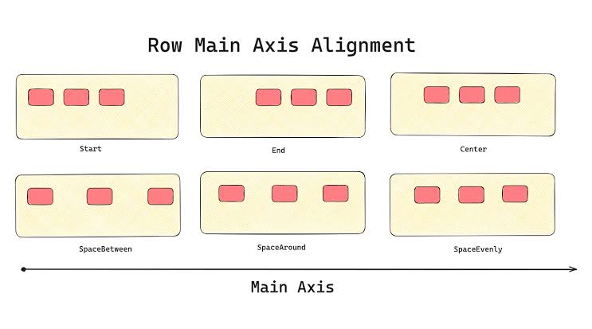

# a TODO collaboration tool with friends

## development
* install serverpod [see quickstart](https://docs.serverpod.dev/quickstart?utm_source=builderbase&utm_medium=event&utm_campaign=hackathon_serverpod_4_26&utm_content=quickstart): `dart install serverpod_cli`
* run project: start server: `serverpod start`
* When using [serverpod_embedded_postgres](https://pub.dev/packages/serverpod_embedded_postgres): `serverpod start`, Serverpod manages a standalone Postgres instance directly without Docker.   To connect using psql, you need two key parameters from your project files:
  * Port, User, and Database Name: Found in `config/development.yaml` 
  * Password: Found in `config/passwords.yaml` 
or start postgres separatelly and see the connection string: `serverpod database start`

### connect physical device on macos in the same WiFi
* find local IP in the WiFi: `ipconfig getifaddr en0`
* update Serverpod's `dotogether_server/config/development.yaml` `publicHost: localhost` to `publicHost: 10.66.11.24`
* start Postgres separately: `serverpod database start`
* start serverpod: `serverpod start --no-flutter`
* start the app: `flutter run -d 00008030-001059C01AEA402E --dart-define SERVER_URL=http://10.66.11.24:8080/`

### Google OAuth2
* [Authentication setup](https://docs.serverpod.dev/next/concepts/authentication/providers/google/setup)
* [Webapp auth callback route](https://docs.serverpod.dev/next/concepts/authentication/setup#web-callback-page-authhtml)
* [runnning web in local dev](https://docs.serverpod.dev/next/concepts/authentication/providers/google/setup#web):
* run web targed locally with making the same origin with serverpod
```shell
flutter build web --base-href / --output ../dotogether_server/web/app  # from your Flutter project
serverpod start --no-flutter                                           # from your server project
```

### using Firebase Auth
* creating application with CLI: `flutterfire configure`

* Example [Accessing Google APIs server-side from a Flutter app](https://serverpod.dev/blog/flutter-google-apis-server-side)

### recreating database *(never try this to avoid troubles! better save `dotogether_server/config/passwords.yaml` in safe place)* 

* run Postgres: `serverpod database start`
* drop database: `DROP database dotogether;` 
* create database: `CREATE DATABASE dotogether;`
* remove migrations: `rm -rf dotogether_server/migrations/*`
* Regenerate code definitions: `serverpod generate`
* Create fresh baseline migration:  `serverpod create-migration`
* apply migration: `dart bin/main.dart --apply-migrations`
```sql
-- 1. Create a dedicated user with a password of your choice
CREATE USER dotogether_user WITH PASSWORD 'my_secure_password_123';

-- 2. Create the application database owned by that user
CREATE DATABASE dotogether OWNER dotogether_user;

-- 3. Grant full privileges on the database to the user
GRANT ALL PRIVILEGES ON DATABASE dotogether TO dotogether_user;

-- 4. Grant schema-level permissions inside the database
\c dotogether
GRANT ALL ON SCHEMA public TO dotogether_user;
```

### Understanding API Server vs Web Server
* API Server (apiServer - Default: Port `8080`): Handles Flutter client communication using WebSockets (for streaming/subscriptions) and HTTP RPC requests (for standard endpoint method calls).

* Web Server (webServer - Default: Port `8082`): Handles standard HTTP requests. This serves static web content, HTML web pages, and incoming OAuth redirect callbacks from external web browsers (like Google or Apple).

#### Adding Custom HTTP Handlers/Routes to the Web Server
* In `Serverpod`, custom HTTP endpoints for the `webServer` are created by extending WidgetRoute (for HTML pages) or Route (for JSON/raw HTTP responses), and then adding them to `pod.webServer`.


### Flutter UI 

